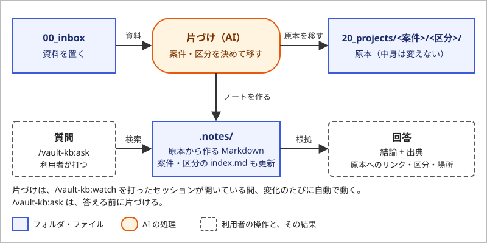
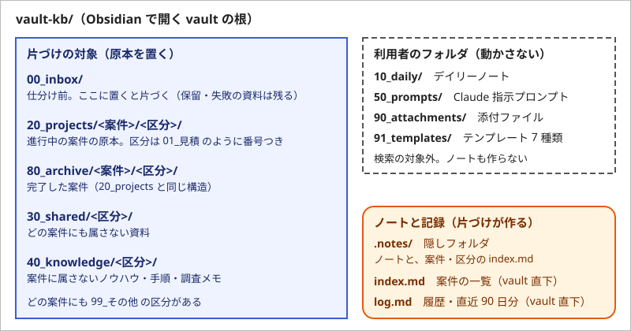

# vault-kb

Claude Code と Obsidian を使う人向けのプラグイン。Obsidian の vault（資料を入れるフォルダ）の `00_inbox` に資料を置くと、AI が案件・区分のフォルダへ片づけ、出典付きで検索・質問に答える。Windows 専用で、自分とチームで使う。

資料を置いてから質問するまでの流れは、次の図のとおり。



## 機能

- **置くだけで片づく。** `00_inbox` に置いた資料を、AI が案件（仕事のまとまり）と区分（見積・設計などの種類）のフォルダへ移す。片づけに承認の確認は出ない。対象は pptx・xlsx・pdf・docx・txt・md・log・cfg・conf・html・htm。
- **探さずに答えが得られる。** 質問すると、原本（元のファイル）へのリンク・区分・場所を付けて答える。同じ資料の複数のバージョンが並ぶときは、日付の新しい方を根拠にする。
- **フォルダが正、ノートは従。** エクスプローラーや Obsidian で原本を動かすと、原本から作った Markdown のノートが追従する。原本の更新・削除も反映される。原本の中身と名前は変えない。
- **案件の全体像がまとまる。** 複数の資料の突き合わせが要る質問をすると、AI が案件ごとの統合ページ（資料を横断したまとめ）を作る・更新する。食い違い・孤立した資料・表記揺れは、修正案つきで統合ページに書かれる。直すのはあなたで、原本もノートも書き換えない。
- **前の答えを使い回す。** 回答は保存され、似た質問には、保存した回答を手がかりにする。使う前に、必ず原本で裏取りする。
- **他のツールでも読める。** ノートは OKF（Open Knowledge Format v0.2。AI ツールが読める知識の形式）で、隠しフォルダ `.notes/` に置く。

## 前提条件

| 項目 | 条件 | 確認 |
|---|---|---|
| OS | Windows 11 | `winver` |
| Claude Code | 2.1.319 で動作を確認した。最低のバージョンは未確認 | `claude --version` |
| Python | 3.12〜3.14 で、`python` で起動できること | `python --version` |
| Obsidian | `vault-kb` という名前のフォルダを、vault として開く | Obsidian で vault を開く |
| ネットワーク | 導入時に PyPI へ接続できること | `/vault-kb:init` の診断 |
| 空き容量 | 約 300 MB（ライブラリ用）。診断は 500 MB 以上の空きを求める | `/vault-kb:init` の診断 |

- Python が 3.12 より古い、または 3.15 以降だと、固定したバージョンのライブラリが入らない。
- ライブラリは markitdown とその依存で、バージョンは固定してある。`/vault-kb:init` が入れるので、手で入れなくてよい。出典とライセンスは [NOTICE](plugins/vault-kb/NOTICE) にある。
- vault の名前が `vault-kb` でないと、`/vault-kb:ask` と `/vault-kb:watch` の読み取りと、計画ファイル（片づけの内容を書く一時ファイル）の編集に、許可の確認が出る。

### 使う前に知っておくこと

- **資料の内容は、Anthropic のクラウドに送られる。** Claude Code を通すため。送りたくない資料は `vault-kb` フォルダに置かない。利用前に、会社の情報取り扱い規則を確認する。log・cfg・conf には、パスワードや接続先が書かれていることがある。置く前に中身を確かめる。
- **既存の vault は、先にバックアップを取る。** `20_projects`・`30_shared`・`40_knowledge`・`80_archive` の中のファイルは、手書きの `.md` も資料として扱われ、案件・区分のフォルダへ動かされる。戻すときは、`log.md` の「元」と「先」のパスを見て、手で戻す。
- **片づけは Obsidian の外でファイルを動かす。** 手書きのノートから、動いた資料へ張ったリンクが、切れることがある。
- **ノートには、原本の全文が平文で残る。** vault を共有・同期するときは、個人名や機密が含まれていないかに注意する。
- **`.wiki/` にも、原本の内容が平文で残る。** 統合ページ・テーマページ・保存した回答は、ノートと同じく、共有・同期するときに注意する。
- **`.wiki/` は、バックアップに含める。** vault のバックアップに、`.wiki/` を入れる。
- **保存した回答と取り消し線の履歴は、消えると戻らない。** 原本から同じ形には作り直せない。これらは増え続け、自動では消えない。整理は手で行う。
- **片づけの操作は、確認なしで通る。** プラグインのフックが、vault-kb 自身の片づけの操作だけを通す。この許可は、プラグインが有効なすべてのセッションで常に効く。他のコマンドの確認は、今までどおり出る。
- **見張り（後述）のセッションには、片づけのたびに資料の本文の抜粋が入る。** 資料に埋め込まれた命令には従わない決まりだが、そのセッションの権限の範囲で効くおそれは残る。出所の分からない資料を扱うときは、見張りを作業用とは別のセッションで打つ。

## 導入方法

既存の vault に入れるときは、先にバックアップを取る（[使う前に知っておくこと](#使う前に知っておくこと)）。Claude Code で、次を実行する。

```
/plugin marketplace add asama0101/vault-kb
/plugin install vault-kb@vault-kb
/vault-kb:init
```

`/vault-kb:init` が、次を行う。

1. 診断（`doctor`）で、動作環境を確かめる。
2. 専用環境（ライブラリを入れる Python 環境）がなければ、作る。承認を求められる。
3. vault のパス（`vault-kb` フォルダ）を、絶対パスで聞く。
4. vault の中に、[フォルダ構成](#フォルダ構成)のとおりフォルダを作る。
5. `91_templates` にノートのテンプレート 7 種類を置く。同名のファイルがあれば、上書きしない。
6. もう一度診断して、vault のパスと片づけ待ちの件数を報告する。

### ライブラリの入れ先

ライブラリは、Claude Code がプラグインごとに用意するデータフォルダの `venv` に入る。システムの Python に固定のバージョンがすでに揃っていれば、入れずにそれを使う。venv も有効なときは、venv を先に使う。

### 診断

診断（`doctor`）は、何も変更せず、動作環境の過不足を表示する。別の PC で使い始めるときの確認に使える。`/vault-kb:init` が最初に実行する。

| 項目 | 見ること | NG のときの対処 |
|---|---|---|
| OS | Windows であること | 対処なし（Windows 専用） |
| Python | 3.12〜3.14 で、`venv` が使えること | 3.12〜3.14 を入れ、新しいターミナルで `python --version` を確かめる |
| `python` コマンド | PATH にあり、実際に起動できること | インストーラの「Add python.exe to PATH」を入れて入れ直すか、PATH に `python.exe` のフォルダを足す |
| 専用環境 | venv か、システムの Python に、固定のバージョンのライブラリが揃っていること | `/vault-kb:init` で入れる |
| PyPI への接続・空き容量 | 専用環境が未作成のときだけ、接続できることと、500 MB 以上の空きを確かめる | プロキシ（`HTTPS_PROXY`）を設定する。ドライブに空きを作る |
| vault | 設定があり、フォルダが実在すること | `/vault-kb:init` で設定する |

満たさない項目には `NG` と原因が付き、その下に対処が出る。次は出力の抜粋で、実際は対処のコマンド（実際のパス入り）が続く。

```
OK  OS
OK  Python
OK  python コマンド: C:\...\python.exe
NG  専用環境: 専用環境が未作成です（システムの Python: markitdown が未導入です）
      対処（実行の承認が要る）: ...
      Claude Code では /vault-kb:init で実行できる。
NG  vault: vault が未設定です
```

- システムの Python を使っているときは、`python` コマンドが同じ Python を指していることも確かめる。違えば NG になる。
- PyPI の確認は、pip の設定（`pip.ini` の `index-url`）を見ない。社内ミラーを使っているときは、この NG を無視してよい。

### 更新

ターミナルで、次を実行し、Claude Code を再起動する。

```
claude plugin marketplace update vault-kb
claude plugin update vault-kb@vault-kb
```

### アンインストール

次を実行すると、プラグイン、専用環境（venv）、設定、確認を省くフックが消える。vault の中身（原本・ノート・索引・`log.md`）は消えない。元に戻すには、導入方法をもう一度実行する。

```
claude plugin uninstall vault-kb@vault-kb
```

システムの Python に入れてあった場合、そのライブラリは消えない。`pip uninstall markitdown` で、本体を消せる。依存のライブラリ（numpy・pandas など）は、他のツールが使っていないかを確かめてから消す。

## 使い方

次のコマンドを使う。

| コマンド | 使う場面 |
|---|---|
| `/vault-kb:init` | 初回の設定。vault や専用環境を変えるとき |
| `/vault-kb:ask` | 資料を探す・質問する。答える前に、未処理の資料を片づける |
| `/vault-kb:lint` | 案件の全ノートを読み直し、統合ページを更新して、資料の食い違いを示す |
| `/vault-kb:watch` | 自動で片づける見張りを始める |
| `/vault-kb:sweep` | いま溜まっている資料を、1 回だけ片づける |
| `/vault-kb:unwatch` | 見張りを止める |

最も基本の使い方は、資料を置いて、質問すること。

1. 資料を、vault の `00_inbox` に置く（例: `見積書_v2.xlsx`）。
2. 質問する。

   ```
   /vault-kb:ask A社システム更改の見積の保守費について、資料に何と書いてある？
   ```

   未処理の資料があれば、答える前に片づける。回答は、結論に続けて出典が付く。次は回答の例で、案件名・区分名・パスは、資料と PC によって変わる。

   ```
   保守費は月額 20 万円です（3 年契約）。
   出典: [[20_projects/A社システム更改/01_見積/見積書_v2.xlsx]]（区分: 01_見積）
   場所: C:\Users\<あなた>\Documents\vault-kb\20_projects\A社システム更改\01_見積\見積書_v2.xlsx
   ```

   資料は `20_projects/A社システム更改/01_見積/` に移り、ノートが `.notes/` にできる。案件名と区分名は、AI が資料から付ける。

### 自動で片づける（見張り）

普段使う Claude Code のセッション（どのフォルダで開いたものでもよい）で、次を打つ。

```
/vault-kb:watch
```

そのセッションが見張りになる。取り残しを片づけたあと、`00_inbox` と案件のフォルダに変化があるたびに、会話と並行して片づける。片づけのたびに、置いた原本のフルパス付きの 1 行が会話に挟まる。

| 状態 | 資料を置いたとき | 片づくタイミング |
|---|---|---|
| 見張りのセッションが開いている | 自動で片づく | 変化を検知したとき |
| セッションを閉じた | 片づけ待ちになる | 次の `/vault-kb:watch`・`/vault-kb:sweep`・`/vault-kb:ask` |

セッションを閉じたら、開き直して、もう一度 `/vault-kb:watch` と打つ。

見張りを止めるときは、どのセッションからでも `/vault-kb:unwatch` を打つ。最後に 1 回片づけてから、終了時点で残っているもの（片づけ待ち・進行中の片づけ・失敗）を一覧にして示す。アプリを閉じるなど、あなたの対応が要るものは、対応して再確認するか、そのまま終了するかを選べる。

### 1 回だけ片づける

見張りを張らずに、いま溜まっている資料を片づけるときは、次を打つ。

```
/vault-kb:sweep
```

片づけた件数と、残っているもの（片づけ待ち・進行中の片づけ）を、1 行で報告する。動いている見張りには触れない。

### 同名のファイルがあるとき

置く先に、同じ名前で中身が違う原本があると、資料は動かさず、元の場所（`00_inbox` か案件フォルダの直下）に残り、報告される。見張りは質問せず、1 行で報告して続ける。中身が同じ資料は、聞かずに置いた側を捨てる。

動かす・消すは、手で行うか、Claude への指示で行う。

### 置き方

- 資料は `00_inbox` に置く。案件のフォルダ（`20_projects/<案件>`）の直下に置くと、その案件の中で区分が決まる。`<案件>/<区分>/` に直接置いてもよい。
- `vault-kb` の直下に置いたファイルは、片づけの対象にならない。自分で書くノート（デイリーノート・ノウハウなど）は、片づけの対象のフォルダの外に置く。
- zip・png・csv など対象外の形式や、文字を取り出せない資料は、置き場所だけ決めて置かれ、ノートの `readable: false` で示される。検索・質問では「文字を取り出せていない」と添えられる。
- 改訂版は、同じフォルダに並ぶだけで、旧版のフォルダは作らない。
- `.md` も資料として片づく。ノートは `<原本の名前>.md.md` になり、`.md` の原本は書き換えない。
- リンク（ジャンクション）は使わない前提。リンクの先が vault の外でも走査される。
- 同じ名前の案件が `20_projects` と `80_archive` にあるときは、`20_projects` が先に使われる。案件名 `shared`・`knowledge` は、`30_shared`・`40_knowledge` の名前なので、`20_projects` には作らない。

### 検索・質問のしかた

- 「基本設計の資料だけ」のように、区分や取引先で絞れる。
- 旧版・過去のバージョン・変更履歴を聞いたときだけ、古いバージョンも根拠にする。
- 「〇〇の資料を探して」と頼むと、題・要約・案件・区分・取引先・種類・日付・原本のリンクの一覧で返る。
- 完了した案件（`80_archive`）も対象になる。
- 読み取りは `vault-kb` フォルダの中に限られる。外のメモを読むときは、読み取りの許可の確認が出る。

### 統合ページと保存した回答

複数の資料の突き合わせが要る質問（食い違い・全体像・比較）では、`/vault-kb:ask` が案件の統合ページを確かめ、なければ作り、古ければ更新する。作る・更新するあいだ、回答は遅れる。ノートが 2 件に満たない案件では、作らない。

- 統合ページは `.wiki/projects/<案件>.md` にあり、読み込みの上限（`/vault-kb:ask` が 30 件、`/vault-kb:lint` が 100 件）を超えた資料は未読として記録される。
- 古くなった記述や誤りは消さず、取り消し線（`~~旧~~（取り消し 日付: 理由）`）にして残る。`/vault-kb:ask` は、取り消し線の部分を今の答えに使わない。
- 回答は、`.wiki/queries/` に自動で保存される（片づけ中は保存に失敗することがあり、そのときは Claude がそう伝える）。似た質問では、保存した回答を手がかりにするが、根拠の原本が変わっていれば使わず、変わっていなくても、原本で確かめた部分だけを使う。

`/vault-kb:lint` は、指定した案件の全ノートを読み直して統合ページを更新し、食い違い・孤立・表記揺れを修正案つきで示す。

```
/vault-kb:lint A社システム更改
```

案件名を省くと、どの案件かを聞かれる。

テーマ（案件をまたぐ話題）のまとめは、テーマを指定して `/vault-kb:ask` に頼むと、`.wiki/themes/<テーマ>.md` にできる。

```
/vault-kb:ask 保守契約のテーマで、案件を横断してまとめて
```

### 間違いは手で動かす

案件・区分が違っていたら、エクスプローラーか Obsidian で、原本を正しい `20_projects/<案件>/<区分>/` へ動かす。次の片づけで、ノートが追従し、案件・区分・索引が合う。新しい案件・区分は、フォルダを作ればよい。

完了した案件は、`20_projects/<案件>` を `80_archive/` へ動かす。ノートが追従し、新しい資料の行き先の候補から外れる。

### フォルダ構成

`/vault-kb:init` が、vault の中にフォルダを作る。ノートと記録は、AI が作る。ノートと `index.md` は片づけが、`.wiki/` は `/vault-kb:ask` と `/vault-kb:lint` が作る。`log.md` には、片づけと統合ページの更新が追記する。片づけが扱うのは、次の図の左の 5 つだけ。



- 案件は `20_projects`・`80_archive` 直下のフォルダ、区分はその下のフォルダ。`30_shared`（案件名 `shared`）と `40_knowledge`（案件名 `knowledge`）は案件に属さない資料で、直下が区分になる。
- `40_knowledge` の直下に置いたファイルは、片づけで区分のフォルダへ動く。既存の `40_knowledge` の中身も、最初の片づけで一括で区分に分かれる。
- 区分は `01_見積` のように番号つきで、`99_その他` はどの案件にもある。番号なしの区分フォルダも、そのまま受け入れる。
- `10_daily`・`50_prompts`・`90_attachments`・`91_templates` は、利用者のフォルダ。動かさず、ノートも作らず、`/vault-kb:ask` の検索にも入らない。
- ノートの先頭の項目欄（frontmatter）に、案件・区分・取引先・種類・日付・要約が入る。
- `.notes/` は隠しフォルダ。見るには、エクスプローラーで「隠しファイルを表示」をオンにする。Obsidian には表示されず、検索にも出ない。
- `.wiki/` も隠しフォルダ。統合ページ（`projects/`）・テーマページ（`themes/`）・保存した回答（`queries/`）が入る。上書き前の旧ページは `.bak/` に 1 世代だけ残る。
- 案件・区分の `index.md` は `.notes/` の中にあり、片づけのたびに作り直される。根の `index.md` と `log.md` は、vault の直下にある。

手で動かしてよいものと、触らないものは、次のとおり。

| 対象 | 可否 | 備考 |
|---|---|---|
| 原本の移動・編集・削除 | 可 | ノートが追従する |
| `20_projects/<案件>/<区分>/` への新しい原本の追加 | 可 | ノートができる |
| `10_daily`・`50_prompts`・`90_attachments`・`91_templates` | 可 | 利用者のもの |
| ノート（`.notes/` の中の `<原本>.md`） | 触らない | 手の編集は消える |
| `.wiki/`（統合ページ・テーマページ・保存した回答・`.bak/`） | 触らない | AI が書く。壊れたページは作り直され、旧ページは `.bak/` に移る。`queries/` の古い回答は手で消してよい |
| `index.md`（`.notes/` の中と根） | 触らない | 編集は消える |
| `log.md` | 触らない | 追記されるだけで、古い履歴も消えない |

- 原本を編集するとノートが作り直され、削除するとノートも消える（原本を戻せば作り直される）。
- `91_templates` に同名のファイルがあっても、`/vault-kb:init` は上書きしない。

## 設定

設定は、vault のパスだけ。`/vault-kb:init` で指定する。vault を変えるときは、もう一度 `/vault-kb:init` を実行する（前の vault のファイルは動かない）。設定と専用環境は、vault の外にある。

### Obsidian の設定

[obsidian-settings.md](obsidian-settings.md) に、このプラグインと合わせて使う Obsidian の設定値の一覧がある。プラグインは `.obsidian` を書き換えないので、一覧を見て手で設定する。フォルダの場所は、次のように指定する。

| 設定 | 指定する場所 |
|---|---|
| コアプラグイン「テンプレート」のテンプレートフォルダの場所 | `91_templates` |
| コアプラグイン「デイリーノート」の新規ファイルの場所 | `10_daily` |
| 「ファイルとリンク」の新規添付ファイルの作成場所 | `90_attachments` |

## 困ったとき

見出しは、画面に出る文言か、起きている症状。まず、`/vault-kb:init` を実行して、診断を見る。`NG` の行と、その下の対処が、原因の手がかりになる。質問や不具合は、[GitHub のリポジトリ](https://github.com/asama0101/vault-kb)の作者に連絡する（Issues は無効）。

### 「/vault-kb:init で設定してください」と出る

専用環境が未作成か、使えない。`/vault-kb:init` を実行して、案内に従って承認する。

### 置いても片づかない

`/vault-kb:watch` を打ったセッションが開いているかを確かめる。閉じていれば、開いたセッションで打ち直す。見張りに確認が出るときは、プラグインが有効か（`/plugin`）と、`/vault-kb:init` の診断が通るかを確かめる。

### `busy` と出る

別の片づけが動いている。見張りと `/vault-kb:ask` が重なった、または片づけの途中で Esc で止めたときで、その回は飛ばされる。少し待てば、次の片づけで拾われる。15 分以上続くときは、見張りのセッションを閉じて開き直す。

### ツールを呼ぶたびに `[vault-kb]` のフックのエラーが出る

`python` が起動できていない（未導入、または Microsoft Store の案内だけが出る状態）。Python 3.12〜3.14 を入れて、`python` で起動できるようにする。診断の `python コマンド` の行が、同じ状態を `NG` で示す。

### 資料が `readable: false` になった

スキャン画像だけの PDF など、取り出せた文字が 20 字未満だった。OCR で文字を入れたファイルを、同じ場所に置き直す。

### ファイルが片づかない・開けないと出る

PowerPoint などで開いたままだと、動かせない。閉じれば、次の片づけで再試行される。パスワード付き・破損のファイルは、`readable: false` で置かれる。

### 資料が `00_inbox` に残っている

置く先に、同じ名前で中身が違う原本がある。動かす・消すは、手か Claude への指示で行う（[同名のファイルがあるとき](#同名のファイルがあるとき)）。

### 結果が途中で止まった（`log.md` を見るよう案内された）

片づけの後処理で、書き込みに失敗している。`log.md` で何が済んだかを確かめ、もう一度片づける。

## ライセンス

[MIT](LICENSE)。
